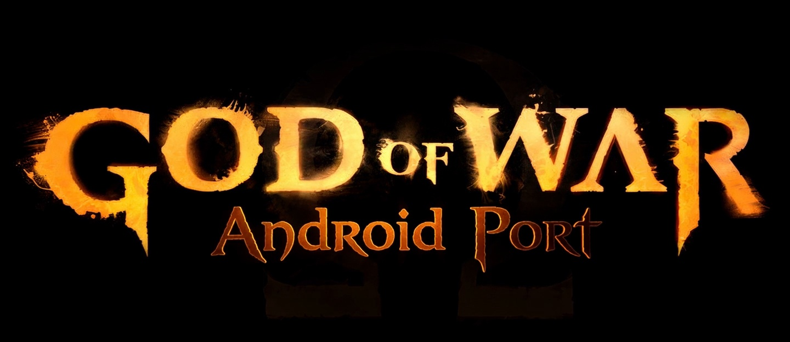

> ## Créditos / Credits
> Este projeto é um fork de **[bc160201983/GoW-Ascension-Recomp](https://github.com/bc160201983/GoW-Ascension-Recomp)**,
> criado por **BilalReloaded** ([YouTube](https://www.youtube.com/@BilalReloaded) · [Patreon](https://www.patreon.com/cw/bilalreloaded)).
> Todo o trabalho de recompilação estática do God of War: Ascension (PPU/SPU, runtime `ps3kit`, renderizador, launcher,
> multiplayer comunitário) é dele, sob licença MIT. O `ps3kit` por sua vez é um fork do
> [ps3recomp](https://github.com/sp00nznet/ps3recomp) (MIT).
> O que existe aqui de novo é **apenas** o trabalho de portar para Android, descrito abaixo.
>
> This is a fork of [bc160201983/GoW-Ascension-Recomp](https://github.com/bc160201983/GoW-Ascension-Recomp) by
> **BilalReloaded**. All the static-recompilation work is his (MIT). This fork only adds the Android port.

<p align="center">
  <a href="docs/media/android-port-title.mp4">
    
  </a>
</p>

# God of War: Ascension — Android Port (ARM64)

**Status: pesquisa / viabilidade. Não jogável. Não existe APK ainda.**

O objetivo **não** é um APK que apenas abre o jogo, e sim **desempenho jogável** num celular real
(alvo de teste: Redmi Note 13 Pro 5G, Snapdragon 7s Gen 2, Adreno 710, 12 GB de RAM). Cada decisão técnica é medida
antes de ser adotada; se o desempenho for insuficiente, o gargalo será documentado e alternativas propostas
antes de continuar investindo.

## Marcos

| Marco | O que é | Estado |
|---|---|---|
| A | Runtime (`ps3kit`) compilando para Android ARM64 | **em andamento** (ver abaixo) |
| B | Vulkan inicializando e apresentando imagem | pendente |
| C | Execução de código PPU/SPU em ARM64 | pendente |
| D | Parte representativa do código lifted rodando | pendente |
| E | Boot do jogo | pendente |
| F | Desempenho em gameplay real (FPS, frametime, CPU, memória, temperatura) | pendente |

### Marco A — resultado atual (branch `android/m0-audit`)

Das 161 fontes do runtime/libs, **149 já compilavam** para `aarch64-linux-android28` sem alteração. As restantes foram
corrigidas com camadas de compatibilidade (o caminho x86 continua intacto):

- `runtime/platform/arch_compat.h`: pause, cópias/comparações de 128 bits e contador de ticks (NEON no ARM64, SSE no x86).
- `runtime/platform/ps3_ucontext.{h,c}`: troca de contexto aarch64 para `cellFiber` (o bionic não tem `ucontext`).
- `win32_compat`: `CreateWaitableTimerExW`, `QueryThreadCycleTime`, afinidade de thread via `sched_setaffinity`.

Ainda pendente no marco A: `cellAudio`, `cellPad` e o backend Vulkan dependem de SDL2 (a migração para SDL3 está
planejada); `ppu_*.cpp` precisam do `ppu_recomp.h` gerado pelo lift.

Achados que afetam o desempenho (a medir, não assumir):
- O modo rápido de float do SPU (`MXCSR` FTZ/DAZ/RZ) só existe no x86; no ARM64 o caminho atual é o exato, mais lento.
  O equivalente é o `FPCR` (FZ/RMode).
- O código PPU lifted é gerado para AVX2+FMA; no ARM64 o `ppu_vmx.h` cai no caminho escalar até existir um caminho NEON.
- O backend Vulkan tem ~3,4 mil linhas contra ~6,8 mil do D3D12: provavelmente faltam recursos/correções.
- O código SPU nativo escrito à mão (`host/spu/natives`) não está no repositório público.

## Como compilar (marco A, só o runtime)

Requer o Android NDK (testado com a r29). Exemplo para uma fonte:

```sh
NDK=$HOME/Android/Sdk/ndk/29.0.14206865/toolchains/llvm/prebuilt/linux-x86_64/bin
$NDK/aarch64-linux-android28-clang -std=gnu11 -O2 -fdeclspec -ffp-contract=off -D_GNU_SOURCE \
  -Ips3kit/runtime -Ips3kit/runtime/platform -Ips3kit/runtime/spu -Ips3kit/include \
  -c ps3kit/runtime/spu/spu_channels.c -o spu_channels.o
```

A configuração CMake Android completa chega nos próximos commits.

## Você precisa do seu próprio jogo

Este repositório não contém dados, código traduzido, firmware nem executáveis do jogo. É preciso um dump legítimo
do **seu** disco (BCES01741 europeu ou BCUS98232 americano). Veja [README.upstream.md](README.upstream.md) para o
pipeline original (Windows) e as notas legais.

## Documentação original

O README completo do projeto de BilalReloaded (compilação, correções, desempenho no PC, multiplayer) está em
[README.upstream.md](README.upstream.md), sem alterações.

*God of War é marca registrada da Sony Interactive Entertainment LLC. Projeto de fãs, sem afiliação.*
